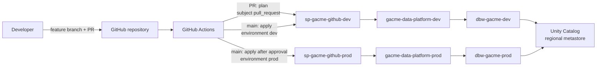

# gacme-lakehouse-platform

Infrastructure as code for the **Azure Databricks lakehouse** behind a four-repo energy data portfolio. Terraform provisions each environment in its own Azure subscription, and GitHub Actions deploys it with **OpenID Connect (OIDC)**: no stored cloud credentials anywhere.


| Repo | Role |
|---|---|
| **gacme-lakehouse-platform** (this repo) | Workspace, Unity Catalog, governance, CI/CD |
| energy-lakehouse-pipeline | EIA ingestion, bronze and silver layers |
| energy-analytics-dbt | Gold star schema |
| energy-analytics-powerbi | Semantic model and report |

> Formerly `databricks-admin-lab`. The history is kept on purpose: it includes a real OIDC failure (`AADSTS700213`) diagnosed and fixed.

---

## Highlights

- **One subscription, one identity, one state per environment.** Dev and prod are separate subscriptions in one Entra ID tenant. Each has its own CI service principal, scoped to its own subscription only, and its own Terraform state. A mistake in dev cannot reach prod.
- **Environment-scoped OIDC trust.** Federated credentials trust a GitHub Environment (`...:environment:dev`), not a branch. Environments only accept deployments from `main`, and prod requires a manual approval.
- **Pull requests never touch prod.** PRs run `plan` against dev only, using a pull-request credential that exists on the dev identity alone.
- **Reproducible bootstrap.** Everything the pipeline needs but cannot create itself (state storage, identities, federation, RBAC, GitHub Environments) is one idempotent script per environment.
- **Unity Catalog governance as code.** Storage credential, external location, catalog, medallion schemas and cluster policies are Terraform, owned by an account group rather than a person.
- **Data outlives compute.** Lakehouse storage lives in its own layer and resource group, and Unity Catalog objects live in the metastore, so the workspace can be destroyed when idle and redeployed without touching data.
- **Least privilege for CI.** The pipeline identity can create role assignments for exactly two roles (Storage Blob Data Contributor and Reader), enforced by an Azure ABAC condition.
- **Reusable modules.** Environments are thin roots over shared modules, so dev and prod differ only in inputs.

---

## Architecture



### Environments

| | dev | prod |
|---|---|---|
| Subscription | `gacme-data-platform-dev` | `gacme-data-platform-prod` |
| CI identity | `sp-gacme-github-dev` | `sp-gacme-github-prod` |
| Role scope | Contributor on the dev subscription only | Contributor on the prod subscription only |
| Terraform state keys | `platform-dev.tfstate`, `platform-dev-lake.tfstate`, `platform-dev-databricks.tfstate` | `platform-prod.tfstate` (lake and databricks layers in Phase 1b) |
| OIDC subjects trusted | `environment:dev`, `pull_request` | `environment:prod` |
| Deploys on | merge to `main` | merge to `main`, after approval |
| Resources | `rg-gacme-dbx-dev`, `dbw-gacme-dev`, `rg-gacme-lake-dev`, `stgacmelakedev`, `dbac-gacme-dev`, catalog `energy_dev` | `rg-gacme-dbx-prod`, `dbw-gacme-prod` |

Prod is deployed to prove the pipeline, captured for this README, then destroyed. The code and the pipeline are the artifact, not an always-on workspace.

---

## Repository structure

```
.
├── .github/workflows/
│   ├── terraform.yml        # Triggers: lint, PR plan on dev, apply on merge, manual deploy/destroy
│   └── _terraform.yml       # Reusable job: runs ci/terraform.sh for one environment
├── ci/
│   └── terraform.sh         # Plans/applies an environment's layers in order (CI and local)
├── bootstrap/
│   ├── bootstrap.sh         # Idempotent one-time setup, per environment
│   ├── dev.env.example      # Copy to dev.env (gitignored)
│   └── prod.env.example     # Copy to prod.env (gitignored)
└── infra/
    ├── modules/
    │   ├── workspace/       # Resource group + Premium workspace (secure cluster connectivity)
    │   ├── lake/            # ADLS Gen2 account, container per domain, access connector
    │   └── governance/      # Storage credential, external locations, catalogs, schemas, cluster policies
    └── envs/
        ├── dev/
        │   ├── lake/        # platform-dev-lake.tfstate
        │   ├── azure/       # platform-dev.tfstate
        │   └── databricks/  # platform-dev-databricks.tfstate
        └── prod/azure/      # platform-prod.tfstate
```

### Layers

Each environment is split into layers with separate state, applied in this order by `ci/terraform.sh`:

| Layer | Owns | Lifecycle |
|---|---|---|
| `lake` | `rg-gacme-lake-<env>`, ADLS Gen2 account, one container per data domain, access connector `dbac-gacme-<env>` with blob access to the account and Reader on itself | Permanent. The storage account has `prevent_destroy`. |
| `azure` | `rg-gacme-dbx-<env>`, workspace `dbw-gacme-<env>` | Destroyed and redeployed to pause the environment |
| `databricks` | Unity Catalog objects and cluster policies, through the workspace | Metastore objects persist across workspace redeploys; policies are recreated |

The `databricks` layer takes the other layers' outputs as inputs, so it is skipped while the workspace or lake is not deployed.

---

## Unity Catalog and governance

| Object | dev | Notes |
|---|---|---|
| Storage credential | `sc_gacme_dev` | Wraps the access connector's managed identity, so no keys or secrets |
| External location | `el_gacme_energy_dev` | `abfss://energy@stgacmelakedev.dfs.core.windows.net/` |
| Catalog | `energy_dev` | Managed storage under the external location; one catalog per data domain |
| Schemas | `bronze`, `silver`, `gold` | Medallion layers |
| Cluster policies | `gacme-dev-single-node`, `gacme-dev-jobs` | Small VM allowlist, single-user (Unity Catalog) access mode, auto-termination, spot for jobs |
| Owner of all of the above | `gacme-platform-admins` | Account group holding the operator and the CI identity; metastore admin |

Adding a data domain (for example weather) means adding a container to the lake layer and a domain to the databricks layer: it gets its own external location and `weather_dev` catalog.

---

## CI/CD pipeline

| Job | Pull request | Push to `main` | Manual run |
|---|:---:|:---:|:---:|
| `lint`: `terraform fmt`, `validate` every root, `shellcheck` | ✅ | ✅ | ✅ |
| `plan dev` (no environment, subject `pull_request`) | ✅ | — | — |
| `apply dev` (environment `dev`) | — | ✅ | `deploy` |
| `destroy dev` (environment `dev`) | — | — | `destroy` |
| `apply prod` (environment `prod`, approval) | — | Phase 1b | — |

### How OIDC trust is scoped

A job's token subject depends on whether it declares a GitHub Environment, and that drives which identity can log in:

| Job | Declares environment | Token subject | Trusted by |
|---|---|---|---|
| PR plan | no | `repo:<owner>@<owner-id>/<repo>@<repo-id>:pull_request` | dev identity only |
| Apply dev | `dev` | `...:environment:dev` | dev identity |
| Apply prod | `prod` | `...:environment:prod` | prod identity |

The ID-based subject still embeds the repository **name**, so renaming the repo requires new federated credentials (`bootstrap.sh <env> federation`).

### Variables

| Variable | Level | Description |
|---|---|---|
| `AZURE_TENANT_ID` | Repository | Shared Entra ID tenant |
| `AZURE_CLIENT_ID`, `AZURE_SUBSCRIPTION_ID`, `TFSTATE_RG`, `TFSTATE_SA` | Each environment | That environment's identity, subscription, and state storage |
| Same four | Repository | Dev values, for the PR plan job, which runs outside any environment |

All are identifiers, not secrets. The repo holds no secrets.

---

## Bootstrap

The pipeline cannot create the identity and state storage it authenticates with, so these are created once per environment from the CLI:

```zsh
cp bootstrap/dev.env.example bootstrap/dev.env      # edit names if needed
az login
bootstrap/bootstrap.sh dev check                     # confirm subscription and repo
bootstrap/bootstrap.sh dev all
```

| Step | Creates (only if missing) |
|---|---|
| `providers` | Registers Storage, Network, Compute, ManagedIdentity, Databricks resource providers |
| `state` | State resource group, StorageV2 account (TLS 1.2, no public blob access), `tfstate` container, blob access for you |
| `identity` | App registration and service principal `sp-gacme-github-<env>` |
| `federation` | `environment:<env>` credential, plus `pull_request` on dev |
| `rbac` | Contributor on the environment's subscription, Storage Blob Data Contributor on its state account, and Role Based Access Control Administrator limited by condition to assigning Storage Blob Data Contributor and Reader |
| `github` | GitHub Environment (main-only deployments, optional required reviewer) and its variables |

Unity Catalog also needs two one-time account console steps, which have no subscription-level API: create the account group `gacme-platform-admins` with you and the CI service principal as members, and make that group the metastore admin.

> Dev reuses the state storage account created before the `gacme` naming (`gdbxlabtfstate24367`). Storage accounts cannot be renamed, and moving state buys nothing.

---

## Local development

```zsh
git checkout -b feat/my-change
terraform fmt -recursive infra
for root in infra/envs/dev/*/; do
  terraform -chdir="$root" init -backend=false && terraform -chdir="$root" validate
done

git commit -am "Describe the change"
git push -u origin feat/my-change
gh pr create --base main --fill      # pipeline posts a dev plan
gh pr checks --watch
gh pr merge --squash --delete-branch # pipeline applies dev
```

To run against real state locally (as yourself, not the CI identity):

```zsh
az account set --subscription gacme-data-platform-dev
export ARM_SUBSCRIPTION_ID=$(az account show --query id -o tsv)
export TFSTATE_RG=<TFSTATE_RG> TFSTATE_SA=<TFSTATE_SA>
ci/terraform.sh dev plan
```

The script is the same one CI runs; locally it authenticates with your `az login` session.

### Access the workspace

Open the Databricks workspace resource in the Azure portal and select **Launch Workspace**. Subscription Owners and Contributors are provisioned as workspace admins on first sign-in. New workspaces are automatically attached to the regional Unity Catalog metastore.

### Access the account console

Account-level administration (identities, metastores, workspace assignment) happens at `https://accounts.azuredatabricks.net`. On Azure, the first sign-in must be performed by a Microsoft Entra ID **Global Administrator**, who then becomes the first Databricks account admin.

This lab uses a dedicated, tenant-native administrator account rather than a personal Microsoft account. Personal accounts are guest identities in the tenant and can be routed to the wrong tenant during account console sign-in.

| Identity | Type | Access |
|---|---|---|
| Tenant admin user (`*@<tenant>.onmicrosoft.com`) | Entra ID member | Global Administrator, subscription Owner, Databricks account admin, MFA enforced |
| Lab owner account | Personal Microsoft account (guest) | Subscription Owner, workspace admin, Azure CLI and Terraform operator |
| `sp-<prefix>-github` | Service principal (OIDC) | CI/CD deployments only |

### Verified state

| Check | Location | Result |
|---|---|---|
| Workspace deployed by pipeline | Azure portal | Premium workspace running in the target region |
| Workspace admin | Workspace **Settings → Workspace admin** | Available to subscription Owners |
| Unity Catalog | Workspace **Catalog** | Regional metastore attached with default workspace catalog |
| Account admin | Account console **User management** | Tenant admin holds the Account admin role |
| Workspace assignment | Account console **Catalog → metastore → Workspaces** | Workspace assigned to the regional metastore |

---

---

## Cost and teardown

An idle workspace costs little, but not nothing: secure cluster connectivity places a NAT gateway in the managed resource group. Clusters (VMs plus DBUs) are the main cost, so use auto-termination and small clusters.

Dev is meant to be paused when idle. From the **Actions** tab, open **terraform**, choose **Run workflow** on `main`, and pick:

- `destroy` to tear down the dev workspace and its resource group (the NAT gateway goes with it). The lake storage and the Unity Catalog objects stay, with their data.
- `deploy` to bring it back, in about 10 minutes

State storage, identities, and federation stay in place, so nothing needs re-bootstrapping. Anything that exists only inside the workspace (UI-created notebooks, jobs, clusters) is lost on destroy; keep it in Git or Terraform. A push to `main` that touches `infra/` also redeploys dev.

---

## Roadmap

- [x] Remote state in Azure Storage with Entra ID authentication
- [x] GitHub Actions CI/CD with OIDC workload identity federation
- [x] Premium workspace with secure cluster connectivity
- [x] Account console access with a dedicated tenant administrator identity
- [x] Phase 0: rename to `gacme-lakehouse-platform`, `gacme` prefix, modules, dev/prod roots, bootstrap script
- [x] Phase 1: Unity Catalog (`energy_dev` catalog, `bronze`/`silver`/`gold` schemas), access connector, external location, cluster policies
- [ ] Phase 1b: prod subscription and identity, `prod` environment with approval gate
- [ ] Account-level groups and entitlements as code (account-scoped Terraform)
- [ ] Audit and usage monitoring with system tables

---

## Lessons learned

| Issue | Resolution |
|---|---|
| `SubscriptionNotFound` when creating storage on a new subscription | Register required resource providers before creating resources |
| `gh` commands failing with `expected the [HOST/]OWNER/REPO format` | Avoid exporting `GH_REPO`, which the GitHub CLI reserves |
| `AADSTS700213: No matching federated identity record` | Match the federated credential subject exactly, including GitHub's owner and repo IDs |
| Workspace sign-in denied for a personal Microsoft account | Launch the workspace from the Azure portal so the correct tenant is used |
| Account console routes a personal account to the wrong tenant | Created a tenant-native Global Administrator for account console administration |
| Pasted `#` comment lines fail in zsh | Enable `setopt interactivecomments` |
| `-ids` federated credentials stopped matching after the repo rename | GitHub's ID-based subject still contains the repo name; added credentials for the new name |
| PR plan needs a different subject than deploy jobs | Declaring `environment:` changes the token subject, so the PR job declares none and dev trusts `pull_request` |
| `Registering a credential requires managed identity (MI) to have a Reader role scoped to MI itself` | Unity Catalog checks the access connector can read itself; Terraform grants it Reader on its own resource |
