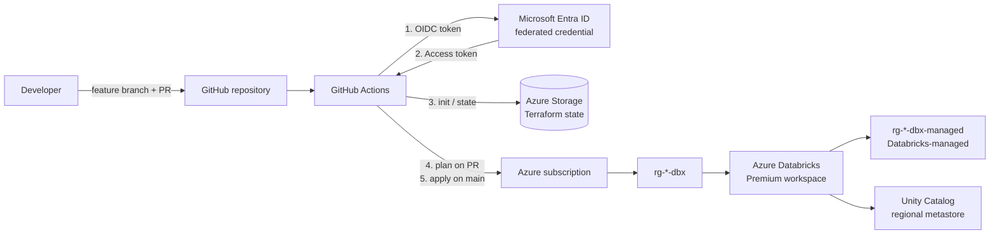

# Databricks Admin Lab on Azure

Infrastructure-as-code lab that deploys and administers an **Azure Databricks Premium workspace** using **Terraform** and **GitHub Actions** with **OpenID Connect (OIDC)** authentication. The lab is a hands-on environment for practicing Databricks platform administration: identities, compute governance, Unity Catalog, CI/CD, and auditing.


---

## Highlights

- **No stored cloud credentials.** GitHub Actions authenticates to Azure through Microsoft Entra ID workload identity federation. The repository holds no client secrets or keys.
- **Pull-request driven changes.** Every change produces a `terraform plan` on the PR for review. Only a merge to `main` runs `terraform apply`.
- **Remote, isolated state.** Terraform state lives in a dedicated Azure Storage account and is accessed through Entra ID RBAC rather than storage account keys.
- **Separated identities.** Distinct identities for CI/CD (service principal), day-to-day operation, and tenant and Databricks account administration.
- **Secure defaults.** The workspace uses the Premium tier with secure cluster connectivity (no public IPs on cluster nodes), a predictable managed resource group name, and consistent resource tagging.

---

## Architecture



| Component | Purpose |
|---|---|
| `rg-<prefix>-tfstate` | Storage account and `tfstate` container for remote Terraform state |
| `sp-<prefix>-github` | Entra ID app registration used by GitHub Actions through federated credentials |
| `rg-<prefix>-dbx` | Resource group containing the Databricks workspace |
| `dbw-<prefix>` | Azure Databricks workspace (Premium, secure cluster connectivity) |
| `rg-<prefix>-dbx-managed` | Managed resource group created and locked by Azure Databricks |

---

## Repository structure

```
.
├── .github/
│   └── workflows/
│       └── terraform.yml   # Plan on PR, apply on merge to main
├── infra/
│   ├── providers.tf        # Terraform + azurerm provider, azurerm remote backend
│   ├── variables.tf        # prefix, location
│   ├── main.tf             # Resource group + Databricks workspace
│   └── outputs.tf          # Workspace URL and ID
├── .gitignore
└── README.md
```

---

## CI/CD pipeline

The workflow in `.github/workflows/terraform.yml` runs when `infra/**` or workflow files change, and can also be triggered manually.

| Stage | Pull request | Push to `main` |
|---|:---:|:---:|
| Checkout and set up Terraform | ✅ | ✅ |
| `terraform init` (remote state, OIDC) | ✅ | ✅ |
| `terraform fmt -check` | ✅ | ✅ |
| `terraform validate` | ✅ | ✅ |
| `terraform plan` | ✅ | ✅ |
| `terraform apply` (from saved plan) | — | ✅ |

### Authentication model

The workflow requests an OIDC token (`permissions: id-token: write`) and passes these values to the AzureRM provider and backend:

| Environment variable | Source |
|---|---|
| `ARM_CLIENT_ID` | `vars.AZURE_CLIENT_ID` |
| `ARM_TENANT_ID` | `vars.AZURE_TENANT_ID` |
| `ARM_SUBSCRIPTION_ID` | `vars.AZURE_SUBSCRIPTION_ID` |
| `ARM_USE_OIDC` | `true` |

Entra ID accepts the token only if its subject matches a federated credential on the app registration. GitHub uses immutable owner and repository IDs in the subject, so two credentials are configured:

| Credential | Subject pattern | Used by |
|---|---|---|
| Main branch | `repo:<owner>@<owner-id>/<repo>@<repo-id>:ref:refs/heads/main` | `apply` |
| Pull requests | `repo:<owner>@<owner-id>/<repo>@<repo-id>:pull_request` | `plan` |

### Required repository variables

Set these under **Settings → Secrets and variables → Actions → Variables**. They are identifiers, not secrets.

| Variable | Description |
|---|---|
| `AZURE_CLIENT_ID` | Application (client) ID of the CI app registration |
| `AZURE_TENANT_ID` | Entra ID tenant ID |
| `AZURE_SUBSCRIPTION_ID` | Target Azure subscription ID |
| `TFSTATE_RG` | Resource group of the state storage account |
| `TFSTATE_SA` | Name of the state storage account |

### Azure RBAC for the CI identity

| Role | Scope | Reason |
|---|---|---|
| Contributor | Subscription | Create resource groups and the workspace (which creates its managed resource group) |
| Storage Blob Data Contributor | State storage account | Read and write the state blob using Entra ID authentication |

> **Note:** Subscription-scope Contributor is appropriate for an isolated lab subscription. In production, scope permissions to specific resource groups and use a separate identity per environment.

---

## Getting started

### Prerequisites

- Azure subscription with Owner rights, in a tenant where you can create app registrations
- GitHub account
- macOS or Linux with `azure-cli`, `gh`, and `terraform` (>= 1.6)

### One-time bootstrap

Bootstrap resources are created once from the CLI because the pipeline cannot create the identity and state storage it depends on.

1. **Register resource providers:** `Microsoft.Storage`, `Microsoft.Network`, `Microsoft.Compute`, `Microsoft.ManagedIdentity`, and `Microsoft.Databricks`.
2. **Create the state backend:** a resource group, a StorageV2 account (TLS 1.2 minimum, public blob access disabled), and a `tfstate` container.
3. **Create the CI identity:** an app registration and service principal, the role assignments listed above, and the two federated credentials.
4. **Set the repository variables** listed above.

### Deploy

```bash
git checkout -b feat/my-change
# edit files under infra/
terraform -chdir=infra fmt -recursive
terraform -chdir=infra init -backend=false
terraform -chdir=infra validate

git commit -am "Describe the change"
git push -u origin feat/my-change
gh pr create --base main --fill      # pipeline posts a plan
gh pr checks --watch
gh pr merge --squash --delete-branch # pipeline applies to Azure
```

### Access the workspace

Open the Databricks workspace resource in the Azure portal and select **Launch Workspace**. Subscription Owners and Contributors are provisioned as workspace admins on first sign-in. New workspaces are automatically attached to the regional Unity Catalog metastore.

### Access the account console

Account-level administration (identities, metastores, workspace assignment) happens at `https://accounts.azuredatabricks.net`. On Azure, the first sign-in must be performed by a Microsoft Entra ID **Global Administrator**, who then becomes the first Databricks account admin.

This lab uses a dedicated, tenant-native administrator account rather than a personal Microsoft account. Personal accounts are guest identities in the tenant and can be routed to the wrong tenant during account console sign-in.

| Identity | Type | Access |
|---|---|---|
| Tenant admin user (`*@<tenant>.onmicrosoft.com`) | Entra ID member | Global Administrator, subscription Owner, Databricks account admin, MFA enforced |
| Lab owner account | Personal Microsoft account (guest) | Subscription Owner, workspace admin, Azure CLI and Terraform operator |
| `sp-<prefix>-github` | Service principal (OIDC) | CI/CD deployments only |

### Verified state

| Check | Location | Result |
|---|---|---|
| Workspace deployed by pipeline | Azure portal | Premium workspace running in the target region |
| Workspace admin | Workspace **Settings → Workspace admin** | Available to subscription Owners |
| Unity Catalog | Workspace **Catalog** | Regional metastore attached with default workspace catalog |
| Account admin | Account console **User management** | Tenant admin holds the Account admin role |
| Workspace assignment | Account console **Catalog → metastore → Workspaces** | Workspace assigned to the regional metastore |

---

## Configuration

| Variable | Default | Description |
|---|---|---|
| `prefix` | `gdbxlab` | Naming prefix applied to all resources |
| `location` | `westus2` | Azure region |

| Output | Description |
|---|---|
| `workspace_url` | HTTPS URL of the Databricks workspace |
| `workspace_id` | Numeric Databricks workspace ID |

All resources are tagged with `project`, `owner`, and `managed = terraform`.

---

## Cost and teardown

An idle workspace with no running compute incurs minimal cost. Charges accrue mainly from cluster VMs and DBUs, so use auto-termination and small clusters for lab work.

To remove the workspace, run `terraform destroy` against the same remote backend. This leaves the state storage and CI identity in place, so the environment can be redeployed later with a single pipeline run.

---

## Roadmap

- [x] Terraform remote state in Azure Storage with Entra ID authentication
- [x] GitHub Actions CI/CD with OIDC workload identity federation
- [x] Azure Databricks Premium workspace with secure cluster connectivity
- [x] Workspace admin access and Unity Catalog metastore verified
- [x] Databricks account console access with a dedicated tenant administrator identity
- [ ] Identity management: account-level groups, users, service principals, entitlements
- [ ] Compute governance: cluster policies, pools, SQL warehouse
- [ ] Unity Catalog: catalogs, schemas, grants, access connector, external locations
- [ ] Databricks Git folders linked to this repository
- [ ] Audit and usage monitoring with system tables
- [ ] Manage Databricks objects with the Databricks Terraform provider

---

## Lessons learned

| Issue | Resolution |
|---|---|
| `SubscriptionNotFound` when creating storage on a new subscription | Register required resource providers before creating resources |
| `gh` commands failing with `expected the [HOST/]OWNER/REPO format` | Avoid exporting `GH_REPO`, which the GitHub CLI reserves |
| `AADSTS700213: No matching federated identity record` | Match the federated credential subject exactly, including GitHub's owner and repo IDs |
| Workspace sign-in denied for a personal Microsoft account | Launch the workspace from the Azure portal so the correct tenant is used |
| Account console routes a personal account to the wrong tenant | Created a tenant-native Global Administrator for account console administration |
| Pasted `#` comment lines fail in zsh | Enable `setopt interactivecomments` |
